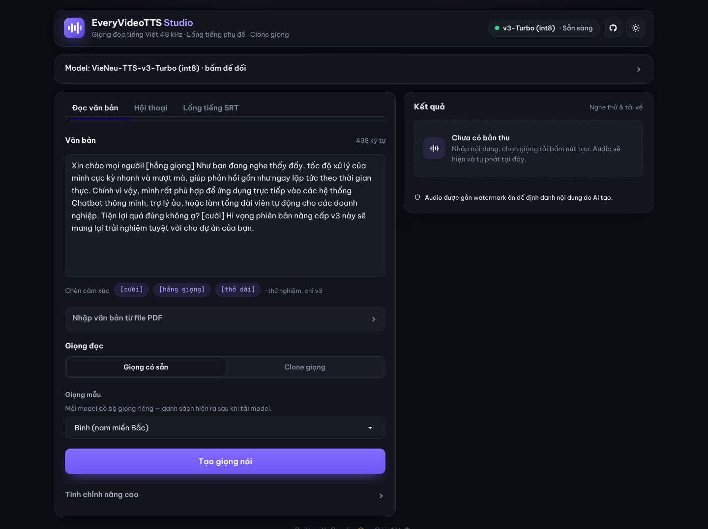
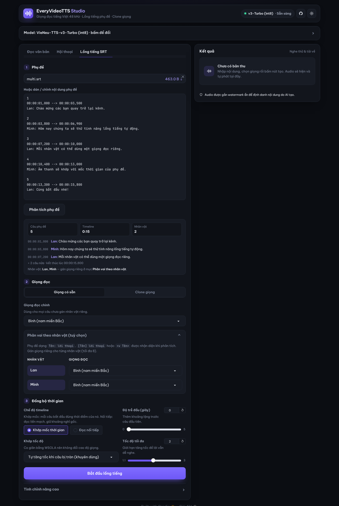

<div align="center">

# 🎬 EveryVideoTTS

**Studio chuyển văn bản thành giọng nói & lồng tiếng video tiếng Việt.**
Biến văn bản, PDF và phụ đề SRT thành giọng đọc tiếng Việt tự nhiên, khớp chính xác từng mốc thời gian.

[](https://github.com/hiimkuroshi/EveryVideoTTS)
[](LICENSE)
[](#installation)
[](#models)

[English](README.md) · **Tiếng Việt**

</div>



## ✨ Điểm nổi bật

- 🎬 **Lồng tiếng từ phụ đề SRT** — tải file `.srt`/`.txt`, nhận về một track audio khớp từng mốc thời gian, kéo thẳng vào timeline video.
- 👥 **Phụ đề nhiều nhân vật** — tự nhận diện người nói (`Tên: lời thoại`, `[Tên] lời thoại`, `<v Tên>lời thoại`), mỗi nhân vật (tối đa 8) có thể dùng một giọng riêng.
- ⚡ **Khớp tốc độ tự động (WSOLA)** — câu nào dài hơn khung phụ đề sẽ được tăng tốc mà không đổi tông giọng. Dùng thuật toán WSOLA miền thời gian thay cho Phase Vocoder nên không bị rè, không có tiếng kim loại.
- 🚀 **Sinh hàng loạt trên GPU** — tối đa 32 câu phụ đề mỗi lô trên CUDA, gom theo độ dài để giảm padding.
- 🎙️ **16 giọng có sẵn** trên v3 Turbo (48 kHz), đủ ba miền Bắc – Trung – Nam, gồm hai giọng mới **Review 1** và **Review 2**.
- 🦜 **Clone giọng tức thì** từ đoạn audio 3–8 giây, tự động khử nhiễu.
- 📄 **Đọc văn bản dài & PDF**, kèm chế độ **hội thoại / podcast** nhiều người nói.
- 😄 **Tag cảm xúc** *(thử nghiệm)*: chèn `[cười]`, `[thở dài]`, `[hắng giọng]` ngay trong văn bản.
- 💻 **Chạy trên mọi máy** — CPU không cần PyTorch (ONNX, int8 mặc định), PyTorch trên GPU NVIDIA và Apple Silicon, có thêm bản cho Intel Arc (XPU).
- 🎨 **Giao diện Studio** — Gradio thiết kế lại, mặc định giao diện tối (có chế độ sáng): trạng thái model trên thanh tiêu đề, tiến độ và thời gian còn lại theo thời gian thực, chèn tag cảm xúc bằng một chạm, dùng tốt trên điện thoại.

## 📌 Mục lục

1. [Cài đặt](#installation)
2. [Sử dụng Studio](#studio)
3. [Lồng tiếng SRT](#srt)
4. [Python SDK](#sdk)
5. [Tự host API server (Docker)](#docker)
6. [Model & giọng đọc](#models)
7. [Tác giả & giấy phép](#author)
8. [Lời cảm ơn](#acknowledgements)

---

## 🦜 1. Cài đặt <a name="installation"></a>

**Yêu cầu:** Python 3.10–3.13 (khuyên dùng 3.12), Windows / Linux / macOS (Apple Silicon). GPU không bắt buộc: NVIDIA với CUDA ≥ 12.8.

1. **Cài `uv`** (trình quản lý gói Python tốc độ cao):
   ```bash
   # Windows (PowerShell)
   powershell -c "irm https://astral.sh/uv/install.ps1 | iex"

   # Linux / macOS
   curl -LsSf https://astral.sh/uv/install.sh | sh
   ```

2. **Clone repo:**
   ```bash
   git clone https://github.com/hiimkuroshi/EveryVideoTTS.git
   cd EveryVideoTTS
   ```

3. **Cài thư viện — chọn một:**

   | Cấu hình | Lệnh | Ghi chú |
   |---|---|---|
   | **CPU / macOS** *(mặc định)* | `uv sync` | Không cần PyTorch. Chạy v3 Turbo bằng ONNX Runtime (int8). Trên Apple Silicon, cách này nhanh hơn bản MPS với v3 Turbo. |
   | **GPU NVIDIA** | `uv sync --group gpu` | Thêm PyTorch. Cần cho lồng tiếng SRT theo lô và clone giọng. |
   | **+ Đọc PDF** | thêm `--extra pdf` | VD: `uv sync --group gpu --extra pdf` |
   | **Intel Arc (Windows)** | `setup_xpu_uv.bat`, sau đó `run_xpu.bat` | Bản Studio riêng cho XPU. |

4. **Khởi động Studio:**
   ```bash
   uv run vieneu-web
   ```
   Mở `http://127.0.0.1:7860`. Model sẽ tự tải từ Hugging Face ở lần đầu bạn bấm tải model.

---

## 🎛️ 2. Sử dụng Studio <a name="studio"></a>

Studio mở ở giao diện tối (đổi sáng/tối bằng nút mặt trời/mặt trăng trên thanh tiêu đề). Thanh tiêu đề luôn cho biết model nào đang dùng; khung **Kết quả** bên phải hiện tiến độ, thời gian còn lại, trình phát và nút **Tải xuống WAV**.

1. **Tải model** — trong **Cấu hình model**, chọn *Model* (trên CPU, `VieNeu-TTS-v3-Turbo (int8)` là nhanh nhất) và *Thiết bị*, rồi bấm **Tải model**. Khung này tự thu gọn khi model sẵn sàng; bấm vào để đổi model. Mục **Gợi ý chọn model** có lời khuyên cho máy CPU / GPU / model tuỳ chỉnh.
2. **Đọc văn bản** — dán văn bản hoặc nhập từ file PDF. Với model v3, các nút **Chèn cảm xúc** chèn `[cười]`, `[hắng giọng]`, `[thở dài]` vào vị trí con trỏ. Chọn **Giọng có sẵn** hoặc **Clone giọng**, rồi bấm **Tạo giọng nói**.
3. **Lồng tiếng SRT** — xem mục tiếp theo.
4. **Hội thoại** — xuất hiện khi model đang tải hỗ trợ hội thoại nhiều người. Viết kịch bản dạng `Tên: lời thoại`, bấm **Quét nhân vật** để nhận diện, gán giọng cho từng nhân vật và chỉnh khoảng lặng giữa các lượt nói.

Temperature, độ dài mỗi đoạn và xử lý theo lô trên GPU nằm trong **Tinh chỉnh nâng cao**. Nút **Dừng** dừng tác vụ đang chạy.

---

## 🎬 3. Lồng tiếng SRT <a name="srt"></a>



1. **Phụ đề** — tải lên file `.srt` / `.txt` (hoặc dán phụ đề) rồi bấm **Phân tích phụ đề**. Bảng tóm tắt hiện số câu, độ dài timeline, các nhân vật và vài câu đầu.
2. **Giọng đọc** — chọn giọng đọc chính (giọng có sẵn hoặc giọng clone). Mục **Phân vai theo nhân vật** tự mở khi tìm thấy nhân vật; gán giọng riêng cho từng người ở đó.
3. **Đồng bộ thời gian** — chỉnh các tùy chọn thời gian, rồi bấm **Bắt đầu lồng tiếng**.

| Tùy chọn | Giá trị | Tác dụng |
|---|---|---|
| Chế độ timeline | **Khớp mốc thời gian** (Strict Sync, *mặc định*) / Đọc nối tiếp (Sequential) | Strict Sync bắt đầu mỗi câu đúng mốc thời gian và chèn khoảng lặng vào chỗ trống (nếu câu trước vẫn bị tràn, câu sau đọc nối ngay sau đó). Sequential đọc nối tiếp các câu và giữ nguyên khoảng cách gốc giữa các phụ đề. |
| Độ trễ đầu (Lead-in) | 0–5 giây | Khoảng lặng trước câu đầu tiên. |
| Khớp tốc độ | **Tự động tăng tốc** *(mặc định)* / Ép khớp 100% / Giữ 1.0× | Tự động tăng tốc chỉ tăng tốc những câu bị tràn khung. Ép khớp 100% tăng hoặc giảm tốc (chậm nhất 0.8×) mọi câu cho vừa khung. Giữ 1.0× không đổi tốc độ. |
| Tốc độ tối đa | 1.1–3.0× (mặc định 2.0×) | Giới hạn mức tăng tốc để giọng vẫn dễ nghe. |

Kết quả là một track WAV (48 kHz với v3 Turbo) khớp với video của bạn.

---

## 📦 4. Python SDK <a name="sdk"></a>

Engine nằm trong gói Python `vieneu` của repo này. Chạy script ngay trong project bằng `uv run python script_cua_ban.py`, hoặc cài vào môi trường khác từ source:

```bash
pip install "git+https://github.com/hiimkuroshi/EveryVideoTTS.git"
```

### Chuyển văn bản thành giọng nói

```python
from vieneu import Vieneu

tts = Vieneu()  # v3 Turbo, 48 kHz. CPU → ONNX int8, CUDA → PyTorch (tự nhận diện)

audio = tts.infer("Xin chào, đây là EveryVideoTTS.", voice="Trúc Ly")
tts.save(audio, "output.wav")

for label, voice_id in tts.list_preset_voices():
    print(label, voice_id)
```

### Lồng tiếng SRT

```python
from vieneu import Vieneu

tts = Vieneu()
audio, stats = tts.infer_srt(
    "examples/sample.srt",
    voice="Minh Đức",                                       # giọng mặc định
    speaker_map={"Phương": "Trúc Ly", "Dũng": "Xuân Vĩnh"},  # tùy chọn, theo nhân vật
    align_mode="sync",            # "sync" hoặc "sequential"
    speed_mode="auto_speed_up",   # "auto_speed_up", "fit_exact" hoặc "none"
    max_speed_factor=2.0,
)
tts.save(audio, "dubbed.wav")
print(f"{stats.get('total_duration_s', 0):.1f}s audio")
```

Ví dụ đầy đủ: [`examples/srt_dubbing_example.py`](examples/srt_dubbing_example.py).

### Clone giọng

```python
audio = tts.infer("Đây là giọng được nhân bản.", ref_audio="my_voice.wav")  # đoạn 3–8 giây, tự khử nhiễu

tts.add_voice("Giọng của tôi", "my_voice.wav")   # lưu một lần…
audio = tts.infer("Dùng lại giọng đã lưu.", voice="Giọng của tôi")  # …gọi lại bằng tên
tts.save_voices()                                # giữ cho phiên sau
```

> `denoise`, `add_voice` và clone giọng cần bản cài PyTorch (GPU). Giọng có sẵn dùng được ở mọi cấu hình.

### Tag cảm xúc, chạy theo lô và streaming

```python
# Tag cảm xúc (thử nghiệm)
audio = tts.infer("Nghe hay quá đi [cười]. Để mình nói tiếp [hắng giọng].", voice="Trúc Ly")

# Nhiều đoạn trong một lượt chạy theo lô (nhanh hơn nhiều trên CUDA; trên CPU chạy tuần tự)
audios = tts.infer_batch(["Câu thứ nhất.", "Câu thứ hai."], voice="Minh Đức")

# Streaming thời gian thực (engine ONNX/CPU, audio trả về theo từng frame)
stream_tts = Vieneu(backend="onnx")
for chunk in stream_tts.infer_stream("Xin chào các bạn!", voice="Minh Đức"):
    ...  # np.float32 @ 48 kHz — phát hoặc ghi ngay khi nhận
```

Demo streaming bằng FastAPI: [`apps/web_stream.py`](apps/web_stream.py), chạy `uv run vieneu-stream` → `http://127.0.0.1:8001`.

---

## 🐳 5. Tự host API server (Docker) <a name="docker"></a>

Build image server (dựa trên LMDeploy) từ repo này và chạy trên GPU NVIDIA (cần [NVIDIA Container Toolkit](https://docs.nvidia.com/datacenter/cloud-native/container-toolkit/latest/install-guide.html)):

```bash
make docker-build-serve
docker run --gpus all -p 23333:23333 -v huggingface_cache:/root/.cache/huggingface everyvideotts:serve --model pnnbao-ump/VieNeu-TTS-v2 --tunnel
```

Sau đó kết nối từ bất kỳ đâu bằng SDK (`pip install "vieneu[legacy] @ git+https://github.com/hiimkuroshi/EveryVideoTTS.git"`):

```python
from vieneu import Vieneu

tts = Vieneu(mode="remote", api_base="http://ip-server-cua-ban:23333/v1", model_name="pnnbao-ump/VieNeu-TTS-v2")
tts.save(tts.infer("Xin chào từ server."), "remote.wav")
```

Tùy chọn khác (Docker Compose, triển khai production, đẩy image lên registry riêng): [`docs/Deploy.vi.md`](docs/Deploy.vi.md) · ví dụ remote đầy đủ: [`examples/main_remote.py`](examples/main_remote.py).

---

## 🔬 6. Model & giọng đọc <a name="models"></a>

EveryVideoTTS chạy trên họ model VieNeu-TTS. Model tự tải từ Hugging Face ở lần đầu sử dụng.

| Model | Engine | Thiết bị | Tần số mẫu | Dùng cho |
|---|---|---|---|---|
| **VieNeu-TTS-v3-Turbo** *(mặc định)* | ONNX (CPU) / PyTorch (GPU) | CPU / GPU | 48 kHz | Giọng có sẵn, clone giọng, tag cảm xúc, lồng tiếng SRT, hội thoại |
| **VieNeu-TTS-v2** | PyTorch (+ LMDeploy) | GPU | 24 kHz | Song ngữ Anh–Việt, chế độ podcast, Docker server |
| **VieNeu-TTS (v1)** | PyTorch | GPU | 24 kHz | Giọng tiếng Việt ổn định |

**Giọng có sẵn (v3 Turbo):**

| Miền | Nam | Nữ |
|---|---|---|
| Bắc | Minh Đức *(mặc định)*, Phạm Tuyên, Thanh Bình | Trúc Ly, Ngọc Linh, Đoan Trang, Mai Anh |
| Trung | Quang Sơn | Ngọc Trân |
| Nam | Thái Sơn, Xuân Vĩnh, Minh Triết | Thục Đoan, Thùy Dung |
| Trợ lý AI | Review 1, Review 2 | — |

Model v2 có 8 giọng: Bình, Tuyên, Vĩnh, Đoan, Ly, Ngọc, Review 1 và Review 2.

Muốn fine-tune giọng riêng bằng LoRA, xem [`finetune/README.md`](finetune/README.md). Cách nạp model tùy chỉnh hoặc LoRA trong Studio: [`docs/CUSTOM_MODEL_USAGE.md`](docs/CUSTOM_MODEL_USAGE.md).

---

## 👤 7. Tác giả & giấy phép <a name="author"></a>

- **Tác giả:** **Tyr** — [github.com/hiimkuroshi](https://github.com/hiimkuroshi)
- **Repository:** [hiimkuroshi/EveryVideoTTS](https://github.com/hiimkuroshi/EveryVideoTTS)
- **Báo lỗi & góp ý:** [GitHub Issues](https://github.com/hiimkuroshi/EveryVideoTTS/issues)
- **Giấy phép mã nguồn:** [Apache 2.0](LICENSE), xem thêm [NOTICE](NOTICE).
- **Model & giọng có sẵn:** CC BY-NC 4.0, **chỉ dùng phi thương mại** và phải ghi nguồn. Phần này không thuộc giấy phép Apache của repo.

### Trích dẫn

```bibtex
@misc{everyvideotts2026,
  title        = {EveryVideoTTS: Advanced Vietnamese Text-to-Speech & Video SRT Dubbing Studio},
  author       = {Tyr},
  year         = {2026},
  howpublished = {\url{https://github.com/hiimkuroshi/EveryVideoTTS}}
}
```

### 🌟 Star History

[](https://star-history.com/#hiimkuroshi/EveryVideoTTS&Date)

---

## 🙏 Lời cảm ơn <a name="acknowledgements"></a>

EveryVideoTTS được phát triển dựa trên [VieNeu-TTS](https://github.com/pnnbao97/VieNeu-TTS) (Apache 2.0) và sử dụng các model của dự án này. Mã hóa âm thanh dùng [neucodec](https://huggingface.co/neuphonic/neucodec) và [MOSS-Audio-Tokenizer-Nano](https://huggingface.co/OpenMOSS-Team/MOSS-Audio-Tokenizer-Nano); chuẩn hóa văn bản và chuyển âm vị dùng [sea-g2p](https://github.com/pnnbao97/sea-g2p).

<div align="center">

**Made with ❤️ by Tyr cho cộng đồng làm video Việt**

</div>
